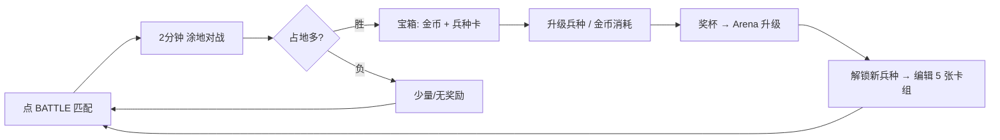
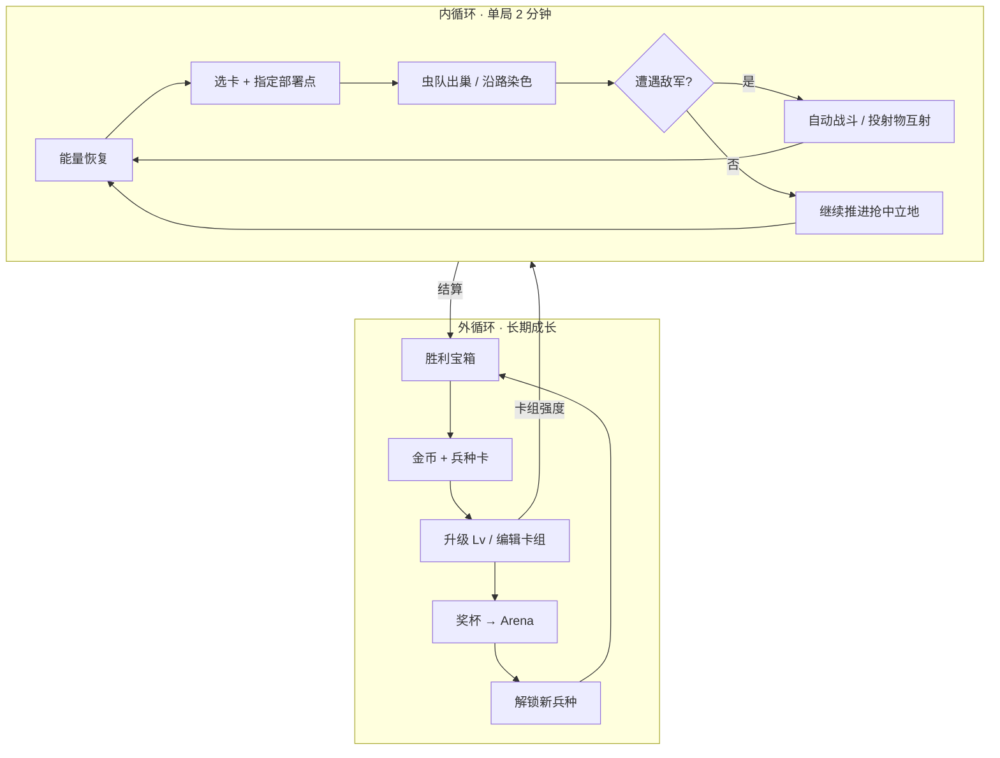
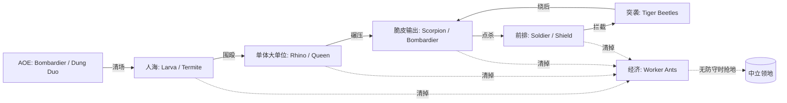

# Ant War · 游戏设计文档（PRD）

> **文档性质**：基于 `ref/` 目录下 17 张 1104×2376 竖屏实机截图的**逆向分析 + 可复刻设计规格**。
> **版本**：v1.0 ｜ **日期**：2026-11-11 ｜ **素材**：`ref/*.jpg`（17 张，含战斗全过程、大厅、卡组收藏、奖励、新手教学）
> **适用对象**：策划 / 客户端 / 美术 / 绘图 AI

---

## 证据等级说明（全文通用）

| 标记 | 含义 |
| --- | --- |
| ✅ **实证** | 截图中可直接读到或看清的内容（文字、数值、颜色、造型） |
| 🔍 **推断** | 由多张截图的时间序列、界面一致性交叉推导，置信度较高 |
| ⚠️ **假设** | 截图中无法确证，为便于复刻而补全的世界观、数值或机制，**必须实测验证** |

> 本文所有中文译名、世界观故事、兵种技能与数值均为**设计补完**，不是原游戏官方设定；原游戏名称、开发商未知，界面语言为英文。第 10 章列出全部待验证问题。

---

## 1. 核心玩法速览（TL;DR）

> **一句话**：这是一款 2 分钟一局的竖屏「卡牌出兵 + 涂地占地」实时对战休闲游戏——你用随时间恢复的能量打出昆虫卡牌，成队的小虫从己方蚁巢涌出、自动向敌阵推进并把走过的方格染成自己的颜色，敌我虫群相遇自动混战。
>
> **几句话展开**：
> - 战场是一张上下对称的方格地图，蓝方在下、红方在上，各守一座蚁巢；中间大片米色中立区是可抢的空白地。✅
> - 顶部实时显示双方占地百分比与倒计时；**时间归零时占地多的一方获胜**，结算文案为 `TIME'S UP! / You hold 93% of the map.` ✅
> - 底部常驻 5 张兵种卡，每张有闪电费用（2~5 费），点选后在地图上部署，消耗能量；能量会随时间自动恢复。✅
> - 单局节奏天然分两段：**前期抢中立地**（截图 1:58 时蓝 27%／红 24%，近半地图无主）→ **后期互相蚕食**（0:50 后中立归零，蓝 74%/红 26% 一路拉到 93%/7%）。🔍
> - 局外循环：胜利 → 开宝箱得金币 + 兵种卡 → 升级兵种 → 攒奖杯升竞技场 → 解锁新兵种 → 调整 5 张卡组 → 再战。✅



---

## 2. 世界观设定

> 本章为**基于截图的创作补完**。凡带 ✅ 的元素均能在截图中找到视觉依据；故事性内容为 ⚠️ 设计设定，用于统一美术、文案与关卡命名的口径。

### 2.1 一句话概念

**「人类眼里几平方米的草坪，是两个虫族帝国用两分钟露水窗口争夺的整片大陆。」**

### 2.2 世界背景：露潮纪

故事发生在老橡树根部的一片草皮之下。虫族的领土不靠城墙，靠**信息素**——一只虫爬过一格土，就留下族群的气味，那格土便「属于」这个族群。

但气味只有在**露水未干**时才能被改写。每天清晨，露水从草叶滚落到土表，短短约两分钟，土壤松软、气味可塑；两个族群便倾巢而出，拼命把自家气味铺满更多方格。露水一蒸干，气味凝固，占比高的一方即赢得这块草皮这一天的所有权。

这条设定直接解释了游戏里最核心的三个机制：

| 机制 | 世界观解释 |
| --- | --- |
| 2 分钟倒计时 + `TIME'S UP!` ✅ | 露水蒸发的窗口期结束，信息素定型 |
| 方格被染成蓝/红 ✅ | 虫群爬过留下信息素，裸土（米色）为无主地 |
| 黄色闪电能量 ✅ | 晨露凝聚的「露滴冲动」，随时间回涌，用于催出一队虫兵 |

### 2.3 战场地理：一方草皮

- **尺度**：俯视微距。屏幕外可见草叶尖、三叶草、碎石、散落的土粒与落叶，边缘有柔和景深，暗示这是草坪中的一个小凹地。✅
- **地形**：整体是一块近似圆形/八边形的沙土平台，被切成规则方格，边缘呈阶梯状收口；上下各有一片起始领地。✅
- **中央障碍**：地图中部左右对称分布两块橄榄绿的凹陷植被/土坎（呈凹字形），形成两条天然通道与一个中央 bottleneck，是兵家必争之地。✅
- **物资**：中立区散落橙色的**腐叶砖**（可搬运的资源方块），被哪一方搬走/浸染就变成该方颜色（蓝/红方块）。✅
- **巢穴**：蓝红双方各一座六边形陶土巢台，中央是通往地下的圆洞，洞口可见一只值守的工蚁；它是单位生成点与阵营象征，但**不是**被摧毁即败的血条建筑。✅

### 2.4 阵营与势力

| 阵营 | 名称（⚠️ 设定名） | 视觉 | 说明 |
| --- | --- | --- | --- |
| 玩家方 | **青颚军团 / The Azure Mandibles** | 亮蓝 `#378CFF`、深蓝 `#0F4E9D` ✅ | 纪律化、工兵体系完整，以工蚁铺地、兵蚁推进见长 |
| 对手方 | **赤壤虫群 / The Vermilion Brood** | 珊瑚红 `#FE514B` ✅ | 同样结构的敌对族群，单位使用红/黑配色镜像；🔍 由百分比条与同款单位镜像推断为 AI 或匹配对手 |

- 中立裸土为米色 `#F6E5CB`，代表尚未被任何族群气味覆盖的沙土。✅
- 双方单位造型**完全相同、仅阵营配色不同**（红黑 vs 蓝橙/绿），这是低成本高辨识度的对战设计。🔍

### 2.5 社会组织：军团制

虫族是高度军事化的社群，有明确分工与军衔符号：

- **新兵教官**：教程中出现的卡通蚂蚁老兵，戴橄榄绿贝雷帽（帽徽是蓝盾）、系蓝色领巾、背斜挎包与背包，手指向卡牌教导新指挥官。✅ 设定名 **「褐须队长 / Captain Hopper」** ⚠️，语气是爽朗的老兵而非说教，文案短促口语化（`To win, h…`／`You have enough cards to upgrade a unit! Let's do it.` ✅）。
- **蚁后 Queen**：Arena 5 解锁的最高费单位 ✅，暗示族群存在王权核心；设定中她不亲临前线太久，而是持续向战场输送虫卵与光环。⚠️
- **兵种分工**：工蚁（劳动/搬运）、兵蚁（战斗）、幼虫（数量）、蜣螂（辎重）、蝎子（突击）……各族群把不同虫种收编为不同兵科，也是「为什么一支部队里会有蝎子和蜣螂」的世界观解释。⚠️

### 2.6 资源体系

| 资源 | 世界观名义 | 游戏作用 | 证据 |
| --- | --- | --- | --- |
| ⚡ 露滴能量 | 晨露凝成的冲动 | 局内出兵消耗，随时间恢复，上限 ≥5 | ✅ 左下黄闪电 + 数字 1~4；Queen 为 5 费 |
| 腐叶砖 | 可搬运的食物/建材方块 | 中立橙色，工蚁搬运，染色后成为己方 | ✅ 场上橙/蓝/红方块、工蚁扛方块 |
| 金币 | 族群的储粮 | 局外升级兵种（截图为 20 币） | ✅ `Upgrade 🪙20`、奖励 `93` |
| 兵种卡 | 征召令 / 虫卵 | 集齐数量后升级等级 | ✅ 奖励 `Lv.1 x9`、卡面 `0/2` |
| 奖杯 | 族群声望 | 提升竞技场，解锁新兵种 | ✅ `Arena 1 · 🏆 0/40` |

### 2.7 竞技场：从苗圃到焦土

奖杯推进解锁 8 个以上竞技场，每个竞技场对应一片更险恶的草地与新归化的虫种。✅ 解锁条件见 6.5。

| Arena | 设定名 ⚠️ | 解锁兵种 ✅ |
| --- | --- | --- |
| 1 | 苗圃湿地 · Seedling Plot | Worker Ants / Soldier Ants / Scorpion Trio / Dung Duo / Larva Platoon |
| 2 | 根茎关口 · Root Gate | Rhino Beetle |
| 3 | 朽木回廊 · Rotwood Gallery | Termite Gang |
| 4 | 苔盾高地 · Mosskeep | Shield Bugs |
| 5 | 王庭土丘 · Royal Mound | Queen |
| 6 | 砾石疾风 · Gravel Run | Tiger Beetles |
| 7 | 卷甲要塞 · Curlhold | Roly-Poly |
| 8 | 灼痕焦土 · Scorchfield | Bombardier |

### 2.8 叙事基调与文案口径

轻松、俏皮、军事化拟人不严肃。全部文案短句、大写强调、无复杂从句：`BATTLE`、`TIME'S UP!`、`You hold 93% of the map.`、`You Got:`、`Claim`、`Coming Soon`、`DAILY CHESTS`。✅
**不要**写史诗、黑暗、血腥或拟真生态纪录片式的文案；受伤表现是单位消失/弹开，无血迹。

### 2.9 世界观 → 机制映射表

| 世界观概念 | 对应系统 | 玩家可感知 |
| --- | --- | --- |
| 露潮窗口 | 单局 120 秒倒计时 | 顶部 `1:58 → 0:00` |
| 信息素染色 | 方格占领与百分比 | 顶部蓝/红条 + 地图变色 |
| 露滴冲动 | 能量条 | 左下闪电数字、卡牌费用 |
| 族群分工 | 12 兵种 / 5 卡卡组 | 收藏与卡组界面 |
| 储粮与征召令 | 金币 + 卡牌升级 | `0/2`、`Upgrade 🪙20` |
| 族群声望 | 奖杯 / 竞技场 | `Arena 1 · 0/40`、锁卡 |
| 晨露战利品 | 每日宝箱 | `DAILY CHESTS` 5 格 |

---

## 3. 游戏系统总览

### 3.1 双层循环



### 3.2 界面地图

| 界面 | 入口 | 核心元素 | 截图 |
| --- | --- | --- | --- |
| 大厅 Battle | 底部导航中 | `Arena 1`、🏆`0/40`、地图缩略图、`DAILY CHESTS` 5 格、红色 `BATTLE` 按钮 | `13d8d2`、`d7a5d1` |
| 战斗 | 点 BATTLE | 顶部百分比条/倒计时、地图、底部 5 卡 + 能量 | 9 张战斗图 |
| 结算 | 时间归零 | `TIME'S UP!` + `You hold X% of the map.` | `000ae4` |
| 奖励 Reward | 结算后 | 宝箱开箱动画 → `You Got:` 金币 + 卡牌 → `Claim` | `811ce4`、`f01622` |
| Collection / Deck | 底部导航左 | 5 张卡组 + `Collection 5/12` 12 张兵种网格 + `Upgrade` | `8587701`、`ebae94` |
| 新手教学 | 首局 / 首次升级 | 暗化遮罩 + 白色气泡 + 教官立绘 + 手势指引 | `d56721`、`9be991`、`ebae94` |
| Coming Soon | 底部导航右 | 占位 | 大厅图 |

### 3.3 系统清单

`实时对战` `领地染色` `能量/费用` `卡牌部署` `单位自动 AI` `近战/远程战斗` `可搬运方块` `胜负判定` `宝箱奖励` `卡牌收集` `兵种升级` `奖杯/竞技场解锁` `卡组编辑` `每日任务` `新手引导` `设置`

---

## 4. 核心玩法 · 详细说明

### 4.1 战场与地图

| 项 | 规格 | 等级 |
| --- | --- | --- |
| 屏幕 | 竖屏 1104×2376（约 9:19.5），战场占上部约 78%，底部约 14% 为卡牌栏 | ✅ |
| 视角 | 正俯视略带 2.5D 厚度，正交投影，无透视消失点；所有立体物件只有顶面 + 极薄侧面 | ✅ |
| 网格 | 正方形方格，边长约 44~48px（原图），格线为同色系浅色细线；地图外缘呈阶梯状 | ✅ |
| 三方色 | 蓝 `#378CFF` / 红 `#FE514B` / 中立米 `#F6E5CB`，中立格有细微点状砂纹 | ✅ |
| 起始区 | 上下各一块阶梯状己方领地，面积大致对称；巢穴位于各自区域中心偏内侧 | ✅ |
| 障碍 | 中部左右对称的橄榄绿 `#706F39` 凹形土坎，不可通行/不可染色，形成两条侧翼通道 + 中央瓶颈 | ✅ |
| 装饰 | 地图外围橄榄绿草地 `#9D9950`，散布草簇、三叶草、粉橙碎石、土粒，带轻微景深虚化 | ✅ |

### 4.2 领地占领规则

1. 每格土地有 `owner ∈ {neutral, blue, red}`。✅ 三色可见。
2. 单位经过中立格或敌方格时，将该格改写为己方颜色（🔍 由百分比随时间单向增长、染色边界呈阶梯状推进推断；原作是否「仅工蚁可染色」待验证）。
3. 顶部分段进度条实时显示 `blue% / neutral(深棕段) / red%`。✅ 例：`39% | 1:44 | 25%` 时中段深棕表示剩余 36% 中立。
4. **后期拉锯**：中立格耗尽后，双方百分比之和为 100%（`74% + 26%`），此时每一次推进都是直接从对手手里抢地。🔍 这是单局从「竞速扩张」转为「正面对抗」的节奏拐点，是玩法最重要的动态平衡设计。
5. 结算时取 `blue%` 与 `red%` 比较，高者胜；文案 `You hold X% of the map.`。✅

### 4.3 出牌与能量

- **能量**：左下黄色闪电图标 + 数字。✅ 截图出现 1 / 2 / 4，🔍 上限必然 **≥5**（因 `Queen` 为 5 费），推测上限 8~10、每 2~3 秒恢复 1 点（⚠️ 需实测）。
- **卡牌栏**：常驻 5 张卡，卡面含名称、兵种插画、底部棕色胶囊内的 ⚡费用。✅ 教学第一局只开放 3 张（`Worker Ants / Dung Duo / Larva Platoon`），后续解锁到 5 张。✅
- **费用区间**：2（Shield Bugs / Termite Gang）、3（多数）、4（Soldier Ants / Larva Platoon / Rhino Beetle）、5（Queen）。✅
- **可用态**：能量 ≥ 费用时卡片为亮米黄底 + 金色描边；能量不足或结算后卡片整体压暗/去饱和。🔍 对比 `ce4ad0`(⚡4，全亮) 与 `1d60b5`(⚡2，全灰)、`000ae4`(⚡4 但 TIME'S UP，全灰)。
- **部署操作**：🔍 选卡后地图上出现落点/方向指示——截图中可见悬浮的蓝/红立方体、蓝色圆点配细长三角箭头、绿色圆点配绿色三角箭头（`7d4f66`、`a86becea`）。推测为「点选卡牌 → 在地图点击/拖动指定投放位置与进攻方向 → 单位自巢穴沿该路径出发」。⚠️ 也可能是纯视觉的弹道拖尾，见 4.4。
- **卡组**：从已解锁兵种中选 5 张组成 Deck，`Collection` 页可升级；卡面显示 `Lv1/Lv2/Lv3` 与 `0/2` 升级进度，蓝色高亮 + 绿色对勾表示已编入卡组。✅

### 4.4 单位与战斗

- **出兵**：每张卡召唤一队同类单位（数量由卡面图标决定，2~20 只不等），从己方蚁巢涌出。✅
- **自动 AI**：玩家不操控单个单位。队伍自行寻路向敌方推进，遇敌自动交战。🔍 截图中单位成纵列/横排行军、在红蓝交界处聚集混战，无选中框或摇杆。
- **单位外观**：真实昆虫卡通化，深色描边、高饱和主体色、黑色多足、橙色或蓝色腹部；阵营以配色区分。✅
- **等级角标**：战场单位头顶有白底黑字小方块 `1`。🔍 最可能是**单位等级角标**（类似《皇室战争》），也可能是血量/编队编号；因蓝色方块上也出现 `1`，尚未定论 → 见第 10 章 Q4。
- **远程弹丸**：放大图中可见蓝/绿/红**圆球 + 同色细长三角拖尾**，以及击中时的白色星形闪光。✅ 说明至少存在远程/喷射类攻击。⚠️ 但 `Bombardier`（喷射甲虫）需 Arena 8 才解锁，而初始战场已有弹丸 → 推测弹丸是通用攻击特效（如蝎子尾刺、巢穴自卫）或对手使用高阶单位，待验证。
- **巢穴告警**：`ef091b` 中蓝方巢台上出现红色 `!` 圆标，🔍 推测为「巢穴附近遭敌 / 防线告警」。
- **战斗结果**：单位消失（无尸体、无血迹），战线随存活单位推进。🔍

### 4.5 腐叶砖（可搬运方块）

这是截图里最容易看漏、但很可能是差异化的机制：

- 中立区散布**橙色圆角立方体**，数量与位置随时间变化。✅ `ce4ad0` 左右各一堆（约 7~8 个），`dea6ae` 左 3 右 2 + 蓝区边一堆。
- `Worker Ants` 卡面明确画着三只蚂蚁**各扛一个蓝色立方体**。✅
- 放大图 `dea6ae` 中，一队黑橙工蚁**逐只扛着橙色/蓝色方块**沿蓝色领地边缘排成一列行进；另有一只工蚁背着 2×2 共 4 个方块。✅
- 红蓝交界的方块呈**半红半蓝**（`a86becea` 放大图），🔍 像是正在被争夺/翻色的地块。

**综合推断 🔍**：方块是可被工蚁搬运的「资源/领土单元」。工蚁把中立方块搬回己方区域或推到前沿，从而加速染色与扩张；被对方占据的方块可被抢回。⚠️ 具体收益（转化为能量？直接计为占地格？）截图无法确证，见第 10 章 Q3。

### 4.6 胜负与结算

1. 倒计时归零 → 战场定格，中央弹出 `TIME'S UP!` 大标题 + `You hold X% of the map.` 副标题，同时禁用出牌。✅
2. 进入 `Reward` 页：红色缎带横幅 + 宝箱（关闭态）→ 开箱动画 → `You Got:` 两个奖励格（金币 `93`、兵种卡 `Lv.1 x9`）→ 蓝色 `Claim` 按钮。✅
3. 奖杯计入 `Arena` 进度（大厅 `🏆 0/40`）。🔍
4. 左上 `X` 随时可退出，右上齿轮为设置。✅

### 4.7 单局时序还原（来自 9 张战斗截图）

| 剩余时间 | 蓝 | 红 | 中立 | 能量 | 场上观察 |
| --- | --- | --- | --- | --- | --- |
| 1:58 | 27% | 24% | 49% | 1 | 开局，仅 3 张卡；工蚁扛方块、幼虫纵列行军 |
| 1:50 | 35% | 24% | 41% | 4 | 教学遮罩 + 教官立绘，紫色兵蚁列阵 |
| 1:44 | 39% | 25% | 36% | 2 | 5 张卡齐；绿色蝎子前压 |
| 1:39 | 41% | 26% | 33% | 4 | 中立区散布大量橙色腐叶砖 |
| 1:24 | 58% | 26% | 16% | 4 | 蓝方推进加速，中央瓶颈交火 |
| 1:18 | 60% | 28% | 12% | 1 | 出现蓝/红/绿三色部署指示标记 |
| 0:50 | 74% | 26% | 0% | 2 | **中立归零**，进入互相蚕食阶段 |
| 0:39 | 78% | 22% | 0% | 1 | 战线压到红区，弹丸与彩色路径点密集 |
| 0:28 | 83% | 17% | 0% | 4 | 巢穴出现红色 `!` 告警 |
| 0:00 | 93% | 7% | 0% | 4 | `TIME'S UP!`，胜利结算 |

🔍 **节奏结论**：前期 60 秒是「铺地竞速」，谁出兵效率高谁吃下中立地；后 60 秒是「阵地拉锯」，卡组战斗力和出兵时机决定能否反推。设计复刻时应保证中立地在 60~80 秒内被分完。

---

## 5. 兵种图鉴 · 12 种

> **通用说明**
> - 费用、Lv、解锁条件、卡面造型均为 ✅ 实证；**定位、技能、数值为 🔍/⚠️ 设计推断**，用于复刻时作为初版参数。
> - 卡面右下角绿色对勾 = 已编入卡组；`0/2` = 升级所需卡牌进度；灰色卡 = 未解锁（带 🔒 + Arena 编号）。✅
> - 初始解锁 5 种（`Collection 5/12` ✅），其余 7 种按竞技场解锁。

### 5.0 总表

| # | 兵种 | 译名 | 费用 | 截图等级 | 解锁 | 编队规模 | 定位 ⚠️ |
| --- | --- | --- | --- | --- | --- | --- | --- |
| 1 | Worker Ants | 工蚁小队 | 3 | Lv1 | 初始 | 3 只 | 经济 / 铺地 / 搬运 |
| 2 | Soldier Ants | 兵蚁 | 4 | Lv1 | 初始 | 4 只 | 近战前排 / 主力 |
| 3 | Scorpion Trio | 蝎子三兄弟 | 3 | Lv1 | 初始 | 3 只 | 高攻突击 / 反大单位 |
| 4 | Dung Duo | 蜣螂双雄 | 3 | **Lv3** | 初始 | 2 只 | 冲撞 / 控制 / 辎重 |
| 5 | Larva Platoon | 幼虫军团 | 4 | Lv2 | 初始 | 约 15~20 只 | 人海 / 大面积铺地 |
| 6 | Rhino Beetle | 犀金龟 | 4 | — | Arena 2 | 1 只 | 重坦 / 破阵 |
| 7 | Queen | 蚁后 | 5 | — | Arena 5 | 1 只 | 最高费核心 / 持续产兵 |
| 8 | Shield Bugs | 盾蝽 | 2 | — | Arena 4 | 2 只 | 低费护盾 / 辅助 |
| 9 | Tiger Beetles | 虎甲 | 3 | — | Arena 6 | 3 只 | 高速突袭 / 切后排 |
| 10 | Termite Gang | 白蚁帮 | 2 | — | Arena 3 | 约 8 只 | 低费群铺 / 破障 |
| 11 | Bombardier | 气步甲 | 3 | — | Arena 8 | 1 只 | 远程 AOE |
| 12 | Roly-Poly | 潮虫炮台 | 3 | — | Arena 7 | 1 只 | 防守 / 定点炮台 |

---

### 5.1 Worker Ants · 工蚁小队

| 项 | 内容 |
| --- | --- |
| 费用 / 等级 / 解锁 | ⚡3 ／ Lv1 ／ 初始 ✅ |
| 外观 ✅ | 3 只小蚂蚁，蓝色方形头/背部、橙色腹部、黑色多足，**每只头顶扛着一个蓝色立方体** |
| 战场形态 ✅ | 黑橙小蚁，散开在中立区；可搬 1 个或 2×2 共 4 个橙色方块排成纵列行进 |
| 定位 🔍 | **经济与铺地核心**。全场唯一明确与腐叶砖交互的单位 |
| 猜测作用 ⚠️ | 移动速度最快、造价低；优先寻路到中立方块 → 搬运回己方领地/前沿 → 该方块计入己方染色面积或转化为能量。战斗能力极弱，遇敌即被清 |
| 复刻建议数值 ⚠️ | HP 20／只，攻击 4，移速 1.4×，染色半径 1 格，可载货 1 格（升级后 2 格） |
| 克制 / 被克 | 克「无人防守的空地」；被所有战斗兵种（Soldier / Scorpion）克制 |
| 使用建议 | 开局第一张必下，趁对手还在集结时抢中立；后期不要单独送 |

### 5.2 Soldier Ants · 兵蚁

| 项 | 内容 |
| --- | --- |
| 费用 / 等级 / 解锁 | ⚡4 ／ Lv1 ／ 初始 ✅ |
| 外观 ✅ | 4 只紫红色兵蚁，巨大钳状大颚、圆鼓腹、紧凑编队 |
| 战场形态 ✅ | 紫色小蚁带 `1` 角标，成群出现在红蓝交界处与敌方领地边缘 |
| 定位 🔍 | **标准近战前排 / 卡组骨架** |
| 猜测作用 ⚠️ | 中等血量、稳定近战输出，用于顶住敌方队列、护送工蚁与幼虫推进；4 费对应「质量」而非「数量」 |
| 复刻建议数值 ⚠️ | HP 90／只，攻击 18，攻速 1.0s，移速 1.0×，射程 近战 1 格 |
| 克制 / 被克 | 克 工蚁、幼虫等脆皮；被 蝎子（高单体）、Bombardier（AOE）克制 |
| 使用建议 | 与 Worker Ants 搭配：先工蚁铺地，兵蚁随后压上守住战线 |

### 5.3 Scorpion Trio · 蝎子三兄弟

| 项 | 内容 |
| --- | --- |
| 费用 / 等级 / 解锁 | ⚡3 ／ Lv1 ／ 初始 ✅ |
| 外观 ✅ | 3 只蝎子，亮黄绿色大钳与尾钩、蓝黑分节躯干、绿色尾刺 |
| 战场形态 ✅ | 绿色大钳单位最常见的前线单位，常深入红区、带 `1` 角标；绿色圆球 + 三角拖尾的弹丸疑似其尾刺攻击 |
| 定位 🔍 | **高性价比突击 / 单体爆发** |
| 猜测作用 ⚠️ | 钳击高单体伤害，尾刺可能带毒或短暂击退；3 费却能换掉 4 费大单位，但自身较脆、只有 3 只 |
| 复刻建议数值 ⚠️ | HP 60／只，攻击 32，攻速 1.2s，附带 2s 减速或击退 1 格，移速 1.15× |
| 克制 / 被克 | 克 Rhino Beetle / Queen 等单体大单位；被 Larva Platoon 人海与 Bombardier AOE 克制 |
| 使用建议 | 防守反击最优：等敌方大单位压到中线再投放，绕后点杀 |

### 5.4 Dung Duo · 蜣螂双雄

| 项 | 内容 |
| --- | --- |
| 费用 / 等级 / 解锁 | ⚡3 ／ **Lv3（截图中最高等级）** ／ 初始 ✅ |
| 外观 ✅ | 2 只圆滚滚蜣螂，背着黄蓝横条纹大粪球，下方各有一枚小黄球，短黑腿 |
| 战场形态 | 战斗中较难与圆球类特效区分，🔍 推测对应场上的圆形滚动体与橙色方块推动 |
| 定位 🔍 | **冲撞控制 / 辎重**；玩家唯一升到 Lv3 的卡，说明是新手期主力培养对象 |
| 猜测作用 ⚠️ | 推着粪球沿直线滚动，碾过路径上的格子直接染色、撞开敌方队列并击退；可能把橙色腐叶砖推成己方颜色。名字中的 Dung 与场上橙色方块呼应 |
| 复刻建议数值 ⚠️ | HP 110／只，撞击 25 + 击退 2 格，滚动路径染色宽 2 格，移速 1.3×（滚动时加速） |
| 克制 / 被克 | 克 密集排队的人海与方块墙；被 高血坦克（Rhino Beetle）挡下 |
| 使用建议 | 侧翼通道直线冲刺，一次打开一大片领地；不要正面撞敌方兵蚁阵 |

### 5.5 Larva Platoon · 幼虫军团

| 项 | 内容 |
| --- | --- |
| 费用 / 等级 / 解锁 | ⚡4 ／ Lv2 ／ 初始 ✅ |
| 外观 ✅ | 一大团密密麻麻的蓝紫色小甲虫/幼虫堆叠，约 15~20 只 |
| 战场形态 ✅ | 紫蓝色小兵带 `1` 角标排成纵列行军（教学截图最清晰）；教学第 3 张卡；开箱奖励正是此卡 `Lv.1 x9` |
| 定位 🔍 | **人海 / 大面积铺地 / 炮灰** |
| 猜测作用 ⚠️ | 单位数量最多，一次铺开覆盖多格，靠数量淹没单体高伤单位、吸收弹丸；单体极脆，怕 AOE |
| 复刻建议数值 ⚠️ | HP 15／只 × 18，攻击 5，移速 0.9×，散开阵型覆盖 3×4 格 |
| 克制 / 被克 | 克 Scorpion / Rhino 等单体；被 Bombardier、Dung Duo 冲撞、Soldier Ants 溅射克制 |
| 使用建议 | 中期中立地将尽时投放，用覆盖面抢最后一波百分比；先派兵蚁吸引火力再跟进 |

### 5.6 Rhino Beetle · 犀金龟（🔒 Arena 2）

| 项 | 内容 |
| --- | --- |
| 费用 / 解锁 | ⚡4 ／ Arena 2 ✅ ｜ 灰色锁卡 ✅ |
| 外观 ✅ | 单体大型甲虫，绿蓝渐变圆壳、深色头部与犄角，低伏厚重 |
| 定位 ⚠️ | **重型坦克 / 破阵先锋** |
| 猜测作用 ⚠️ | 全卡最高血量之一，直线冲撞撞开敌方队列与方块墙，吸收远程火力，为身后单位开路；4 费单体意味着「质量换数量」 |
| 复刻建议数值 ⚠️ | HP 400，攻击 20，冲锋伤害 60 + 击退，移速 0.7×，占 2×2 格 |
| 克制 / 被克 | 克 低伤人海、方块墙；被 Scorpion 尾刺、Larva 围殴、Tiger Beetles 绕后克制 |
| 世界观 | 苗圃之外第一道关口的守门巨兽，被青颚军团驯化后用作攻城锤 ⚠️ |

### 5.7 Queen · 蚁后（🔒 Arena 5）

| 项 | 内容 |
| --- | --- |
| 费用 / 解锁 | ⚡**5（全场最高）** ／ Arena 5 ✅ ｜ 灰色锁卡 ✅ |
| 外观 ✅ | 黄黑横条纹长腹、膜质翅、细长触角的蜂形虫，体态比其它兵种修长 |
| 定位 ⚠️ | **后期卡组核心 / 持续价值** |
| 猜测作用 ⚠️ | 5 费决定了她是「一局只能出一两次」的战略卡。最可能是驻场型：周期性孵化免费小虫，或提供信息素光环（周围友军移速/染色/攻击提升）。也可能是超大范围一次性铺地 |
| 关键推论 🔍 | **能量上限必然 ≥5**，否则此卡永远无法打出 → 截图里反复出现的 ⚡4 只是玩家持续消耗后的瞬时值 |
| 复刻建议数值 ⚠️ | HP 220，每 4s 产 2 只工蚁，光环半径 4 格（友军 +20% 攻速 / 染色速度），移速 0.5×，存活上限 30s |
| 克制 / 被克 | 克 消耗战；被 Tiger Beetles 突袭、Scorpion 点杀克制 |
| 世界观 | 王庭土丘的统治者，亲临前线意味着这一战押上了族群的未来 ⚠️ |

### 5.8 Shield Bugs · 盾蝽（🔒 Arena 4）

| 项 | 内容 |
| --- | --- |
| 费用 / 解锁 | ⚡2 ／ Arena 4 ✅ ｜ 灰色锁卡 ✅ |
| 外观 ✅ | 2 只盾形蝽，棕红/蓝色背甲呈宽盾状，边缘带橙色斑，短足 |
| 定位 ⚠️ | **低费功能卡 / 护盾辅助** |
| 猜测作用 ⚠️ | 2 费最便宜档，给周围友军套吸收盾或格挡远程弹丸，护送工蚁/幼虫安全铺地；自身输出可忽略 |
| 复刻建议数值 ⚠️ | HP 70／只，为半径 3 格内友军提供 40 点护盾，持续 6s，移速 0.9× |
| 克制 / 被克 | 克 Bombardier 远程、弹丸流；被 近战爆发（Scorpion）克制 |
| 使用建议 | 2 费使其可高频循环，适合作为「过牌 + 保牌」填充卡组曲线 |

### 5.9 Tiger Beetles · 虎甲（🔒 Arena 6）

| 项 | 内容 |
| --- | --- |
| 费用 / 解锁 | ⚡3 ／ Arena 6 ✅ ｜ 灰色锁卡 ✅ |
| 外观 ✅ | 数只紫色虎甲，长腿细身、大颚前伸，姿态极具速度感 |
| 定位 ⚠️ | **高速突袭 / 切后排 / 骚扰** |
| 猜测作用 ⚠️ | 全场最快移速，可绕开中央瓶颈从侧翼直插敌方腹地，在敌方后方大量染地迫使对手回防；也可能优先攻击 Queen/远程单位。取自真实虎甲「奔跑最快的昆虫之一」的意象 |
| 复刻建议数值 ⚠️ | HP 45／只，攻击 22，移速 1.8×，无视方块阻挡，优先锁定远程/产兵单位 |
| 克制 / 被克 | 克 Queen、Bombardier、后方空地；被 Shield Bugs、Soldier Ants 正面拦截克制 |

### 5.10 Termite Gang · 白蚁帮（🔒 Arena 3）

| 项 | 内容 |
| --- | --- |
| 费用 / 解锁 | ⚡2 ／ Arena 3 ✅ ｜ 灰色锁卡 ✅ |
| 外观 ✅ | 一群绿黑色长条形白蚁，密集朝同一方向排列 |
| 定位 ⚠️ | **低费群铺 / 破障工兵** |
| 猜测作用 ⚠️ | 2 费小群，除了少量铺地，最大价值可能是**啃除地图上的橄榄绿障碍/敌方腐叶砖**，打开新通路，改变战场几何。取自白蚁分解木质/啃蚀的意象 |
| 复刻建议数值 ⚠️ | HP 12／只 × 8，攻击 4，对障碍/方块伤害 ×5，移速 1.1× |
| 克制 / 被克 | 克 方块墙、龟缩防守阵型；被一切 AOE 与近战克制 |
| 世界观 | 朽木回廊的拆迁队，被收编后专治堵路的地形 ⚠️ |

### 5.11 Bombardier · 气步甲（🔒 Arena 8）

| 项 | 内容 |
| --- | --- |
| 费用 / 解锁 | ⚡3 ／ Arena 8 ✅ ｜ 灰色锁卡 ✅ |
| 外观 ✅ | 蓝绿色细长甲虫，**尾部高举一枚绿色圆球**（蓄势待发的化学弹） |
| 定位 ⚠️ | **远程范围伤害 / 清人海** |
| 猜测作用 ⚠️ | 尾部喷射化学弹丸炸开 AOE，专门清 Larva / Termite 这类人海。取自真实气步甲喷射高温醌类液体的习性 |
| 强关联证据 ✅ | 战场放大图里明确有**蓝/绿/红圆球 + 同色细长三角拖尾**的飞行弹丸、白色星形爆点 —— 与卡面尾部绿球造型一致 |
| 疑点 🔍 | 该卡需 Arena 8 才解锁，但初始对局已有弹丸 → 弹丸更可能是通用远程攻击表现（蝎子尾刺 / 巢穴自卫 / 对手高阶单位）。见第 10 章 Q5 |
| 复刻建议数值 ⚠️ | HP 55，射程 5 格，攻击 28（半径 1.5 格 AOE），攻速 1.8s，移速 0.8× |

### 5.12 Roly-Poly · 潮虫炮台（🔒 Arena 7）

| 项 | 内容 |
| --- | --- |
| 费用 / 解锁 | ⚡3 ／ Arena 7 ✅ ｜ 灰色锁卡 ✅ |
| 外观 ✅ | 造型最特别：黄色球体躯干、两侧蓝色轮状附肢、**顶部一根朝上的蓝色中空圆筒（明显像炮管/烟囱）**；看不出昆虫头部 |
| 定位 ⚠️ | **定点防守 / 炮台 / 滚球** |
| 猜测作用 ⚠️ | 两种可能：① 落地后蜷成球原地架炮，喷射弹丸封锁一片已占领的格子；② 蜷球滚动碾压路径。顶部圆筒强烈支持「固定炮台」。取自潮虫遇险蜷球的习性 |
| 复刻建议数值 ⚠️ | HP 180，部署后不可移动，射程 4 格，攻击 15／1.2s，附带减速；或滚动形态造成路径击退 |
| 克制 / 被克 | 克 推进中的人海与突袭；被 Tiger Beetles 绕开、Bombardier 远程拆掉克制 |

### 5.13 克制关系与卡组构筑



**初始卡组（截图实证）**：`Worker Ants 3 / Dung Duo 3 / Larva Platoon 4 / Soldier Ants 4 / Scorpion Trio 3`，平均费用 **3.4** ⚡。✅

- 🔍 这是一条教科书式的新手曲线：**1 张经济 + 2 张三费功能/突击 + 2 张四费质量**，保证任何时刻手牌里都有能打出的低费牌。
- ⚠️ 复刻建议：卡组固定 5 槽、平均费用控制在 3.0~3.6；加入 2 费卡（Shield Bugs / Termite Gang）可显著加快循环，加入 Queen 则需把其余 4 张压到 3 费以下。
- 🔍 **升级优先级启示**：玩家把 `Dung Duo` 升到 Lv3、`Larva Platoon` 升到 Lv2，其余 Lv1 —— 说明开箱资源倾向重复投放在「使用频率最高的低费卡」，复刻时应让低费卡的碎片掉率更高。

---

## 6. 成长与元游戏

### 6.1 竞技场与奖杯 ✅

- 大厅显示 `Arena 1` 与 `🏆 0/40` 进度条。推测每赢一局获得若干奖杯，满 40 升至 Arena 2；失败可能扣杯。⚠️
- 竞技场是**兵种解锁闸门**，共至少 8 级（见 2.7 / 6.5）。

### 6.2 宝箱与每日奖励 ✅

- `DAILY CHESTS` 横排 **5 格**：第 1 格显示绿色对勾（已领取），其余 4 格为宝箱图标。🔍 推测为「每日赢得 N 场 / 完成 N 次对战」依次解锁 5 个宝箱。
- 奖励页：宝箱关闭 → 开启动画 → `You Got:` 两格奖励（`🪙93` + `兵种卡 Lv.1 x9`）→ `Claim` 领取。✅

### 6.3 卡牌收集与升级 ✅

- `Collection 5/12`：共 12 种兵种，当前已解锁 5 种。
- 已解锁卡：棕色卡面、显示 `Lv N`、底部 `0/2`（升级进度）、右下绿色对勾（已入卡组）；选中态为蓝色高亮卡面。
- 满足条件时出现绿色 `Upgrade` 按钮 + `🪙20`；教学有专门一步用白色手势指向它（`ebae94`）。
- 未解锁卡：灰色去饱和、名称可见、底部 `🔒 Arena N`。
- 大厅教学气泡：`You have enough cards to upgrade a unit! Let's do it.` ✅

### 6.4 经济关系 🔍

```
对战胜利 → 宝箱 → 金币 + 兵种卡(碎片)
                    ↓                ↓
              支付升级费用      凑满 x/2 进度
                    └────→ 兵种 Lv+1 ────┘
                              ↓
                        卡组变强 → 更多胜场 → 奖杯 → Arena → 新兵种
```

⚠️ 待验证：金币与卡牌是否都能从宝箱获得、失败是否给奖励、`0/2` 的 2 是否随等级递增。

### 6.5 解锁曲线 ✅

| 竞技场 | 解锁 | 费用 | Arena | 解锁 | 费用 |
| --- | --- | --- | --- | --- | --- |
| 初始 | Worker Ants / Soldier Ants / Scorpion Trio / Dung Duo / Larva Platoon | 3/4/3/3/4 | 5 | Queen | 5 |
| 2 | Rhino Beetle | 4 | 6 | Tiger Beetles | 3 |
| 3 | Termite Gang | 2 | 7 | Roly-Poly | 3 |
| 4 | Shield Bugs | 2 | 8 | Bombardier | 3 |

🔍 设计意图：解锁顺序刻意**按「功能类型」而非「强度」递进**——坦克(2) → 破障(3) → 辅助(4) → 核心(5) → 突袭(6) → 防守(7) → 远程(8)，每次解锁都带来一种新的战术维度，而不是纯数值膨胀。

---

## 7. UI / UX 规格

### 7.1 战斗 HUD ✅

| 位置 | 元素 | 规格 |
| --- | --- | --- |
| 左上 | `X` 退出 | 半透明深灰圆底 + 白叉 |
| 顶部中 | 分段占领条 | 圆角长条，左蓝 `#378CFF` 右红 `#FE514B`，中段深棕为中立；两端内嵌白色百分比 |
| 顶部中下 | 倒计时 | 米色圆角胶囊 + 深棕粗体 `1:44` |
| 右上 | 齿轮设置 | 灰蓝齿轮 |
| 底部 | 卡牌栏 | 棕褐底 `#8F776D`，左侧大闪电 + 能量数字，右侧 5 张竖卡 |
| 卡片 | 米黄 `#FAEAD1` + 金色圆角描边，顶部深色粗体名称（两行），中部兵种插画，底部深棕胶囊 + 黄闪电 + 白色费用数字 |

### 7.2 大厅 ✅

暗棕径向渐变背景 `#7E694A` → 四周更暗；`Arena 1` 居中标题 + 倒 V 形指示；🏆 进度条 `0/40`；圆形战场缩略图（树丛、蚁巢、树枝、石子）；`DAILY CHESTS` 胶囊标签 + 5 格宝箱条；大红色 `BATTLE` 按钮（`#FA4F48`，粗黑描边 + 白色粗黑体字）。
底部三栏导航：`Collection`（彩色卡片图标，带红点未读）、`Battle`（交叉武器/木板图标，选中态青蓝 `#719294` 凸起）、`Coming Soon`（灰蓝）。

### 7.3 收藏 / 卡组 ✅

米黄背景 `#E8D9B8`；`Deck` 区 5 张横排卡（左上角黄色闪电角标 + `Lv N`）；`Collection 5/12` 标题带蓝色书本图标；3 行 × 4 列兵种网格；卡片状态见 6.3；右上无货币栏时左上角深色胶囊显示金币数（113/108）。

### 7.4 新手教学 ✅

全屏压暗遮罩（约 50% 黑）+ **挖空高亮**目标区域；白色矩形气泡 + 指向目标的小三角，内含黑色粗体短句；教官立绘（戴贝雷帽的拟人蚂蚁）从底部探入，用手指向目标卡；白色手套手势 + 青色光晕指向按钮。战斗内教学（1:50）还会把战场变暗并暂停感地展示提示。

### 7.5 反馈与状态 🔍

| 状态 | 表现 |
| --- | --- |
| 能量足够 | 卡片亮米黄 + 金边 |
| 能量不足 / 已结算 | 卡片整体去饱和压暗 |
| 已编入卡组 | 卡面蓝色高亮 + 右下绿色对勾 |
| 可升级 | 绿色 `Upgrade` 按钮 + 向上箭头 + 金币数 |
| 未解锁 | 灰色卡 + 🔒 + `Arena N` |
| 巢穴告警 | 红色圆形 `!` 悬浮在巢台上 |
| 命中 | 白色四角星闪光 + 弹丸爆散 |

---

## 8. 复刻用初始数值假设 ⚠️

> 全部为**待实测的初版参数**，仅用于搭起可玩的原型，不代表原作数值。

| 参数 | 建议值 | 依据 |
| --- | --- | --- |
| 单局时长 | 120 s | 截图最高 `1:58`，结算 `0:00` |
| 能量上限 | 8（**必须 ≥5**） | Queen 5 费；截图瞬时值 1~4 |
| 能量恢复 | 1 点 / 2.5 s，开局给 4 | 截图 1:58 为 1、1:50 为 4，玩家持续消耗 |
| 地图网格 | 约 20 × 24 格 | 由方格边长与画面宽度估算 |
| 起始领地 | 各约 25% | 1:58 时 27% / 24% |
| 中立地清空时点 | 60~80 s | 0:50 已无中立 |
| 单位移速 | 1.0× ≈ 2 格/s | 视觉节奏 |
| 染色方式 | 单位经过即染色，1 格/单位/0.2s | 百分比增长速度 |
| 每日宝箱 | 5 个 | `DAILY CHESTS` 5 格 |
| 升段奖杯 | 40 | `0/40` |
| 升级消耗 | 金币 20 + 卡 `0/2` | `Upgrade 🪙20` |
| 胜利金币 | 约 90~100 | 奖励 `93` |
| 胜利卡包 | 约 9 张 | `Lv.1 x9` |
| 卡组槽位 | 5 | Deck 5 张 |

---

## 9. 美术风格规范（Art Direction）· 供绘图 AI 复现

> 本章独立成章，目标是**把风格写成可执行规格**：给出投影、造型、描边、光影、材质、精确色值、逐元素画法、动效、可直接复制的 Prompt 与负面词。绘图 AI 只需读这一章即可产出风格一致的新资产。
> 所有 HEX 值由 `ref/` 截图取样（区域众数 / 颜色量化）得到 ✅，个别因截图压缩有 ±3 偏差。

### 9.1 风格定位（一句话锚点）

> **「低多边形卡通 × 微距昆虫世界 × 正俯视 2.5D 棋盘」**：像把《皇室战争》的角色造型语言、涂色格子的极简几何、和儿童绘本里的橡皮泥质感，一起缩小到一块草坪上。

对标参照（用于给绘图 AI 定坐标，**只借风格不抄内容**）：Supercell 系卡通造型（圆润体块、深色描边、夸张大部件）、休闲涂色游戏的纯色格子、微距自然绘本的草地背景。
**明确不是**：写实昆虫、像素画、赛博朋克、暗黑哥特、日式二次元立绘、等距 isometric 建筑、PBR 金属玻璃质感、厚涂油画。

### 9.2 投影与空间

| 项 | 规格 |
| --- | --- |
| 视角 | **正俯视（top-down / 90°）**，略带 2.5D 立体厚度；不是等距 isometric，没有 45° 轴 |
| 投影 | 正交（orthographic），无透视收缩、无消失点；屏幕上下 = 世界南北 |
| 立体表现 | 物件只露**顶面 + 一层极薄的正面/侧面**（厚度约 6~10 px @1104 宽），侧面比顶面暗 15~25% |
| 阴影 | 柔和的**接触阴影**（物件右下方偏移 4~8 px 的半透明深色椭圆），无长投影、无方向性强光 |
| 景深 | 仅战场外围的草叶/碎石带轻微模糊，战场本体全程锐利 |

### 9.3 造型语言

- **体块**：圆角几何体拼装——球体、胶囊、圆角立方体、半球；**绝不出现锐角、尖刺状写实解剖结构**。
- **比例**：头 : 胸 : 腹 ≈ 1 : 1 : 1.4，头略大；眼睛为非必须（多数战斗单位不画眼，只有教程立绘画大眼）。
- **昆虫部件夸张化**：大颚、钳子、尾钩、触角、背壳、圆球货物对比身体放大 1.5~2 倍，一眼能认出兵种。
- **多足**：黑色细短圆柱腿，左右各 3 条，简化为 2~3 段折线，末端圆头；不画关节毛刺。
- **表面光**：每个体块顶部有一块**偏白的柔和弧形高光**（约 20% 面积），底部一圈暗色环境遮蔽；不做镜面反射。
- **描边**：所有主体带 **2~4 px（@1104 宽）深棕黑描边 `#2F2621` / `#572F26`**，线宽均匀、圆角接头；UI 按钮用更粗的 4~6 px 近黑描边 + 硬阴影。

### 9.4 材质与笔触

- 哑光「软塑料 / 橡皮泥 / 黏土」质感，**无纹理贴图**，靠色块分层表现体积（亮面 / 固有色 / 暗面 三段）。
- 渐变仅限：大面积背景（径向暗角）、球体高光、UI 条；**单位本身用平涂 + 硬边色块**，不要喷枪渐变。
- 沙土中立格上有极细的**点状砂纹**（每格 1~2 个浅棕小点），这是唯一允许的重复纹理。
- 整体干净、无噪点、无颗粒滤镜、无脏污、无划痕。

### 9.5 精确色板 ✅

**A. 战场核心色（必须严格使用）**

| 用途 | HEX | 备注 |
| --- | --- | --- |
| 蓝方领地 | `#378CFF` | 亮天蓝，最高饱和主色 |
| 蓝方领地暗面 / 格线 | `#205CA9` | 同色系加深 |
| 红方领地 | `#FE514B` | 珊瑚红，非正红 |
| 红方领地暗面 | `#EA463B` / `#B73515` | 侧面与阴影 |
| 中立裸土 | `#F6E5CB` | 奶油米色 |
| 中立土阴影 / 描边点 | `#EDD7AF` | 砂纹与凹面 |
| 草地背景亮 | `#9D9950` | 橄榄黄绿 |
| 草地背景暗 | `#706F39` / `#626333` | 凹陷与暗角 |
| 障碍土坎 | `#6F6F3D` + 顶部亮边 `#8A8A50` | 中部对称凹形块 |
| 草叶装饰 | `#6D9453` / `#4E8B3A` | 高饱和草绿 |
| 腐叶砖（中立） | `#E8A24A` → `#C87830` | 橙色圆角立方体，顶面亮侧面暗 |
| 蓝/红方砖 | `#378CFF` / `#FE514B` | 与领地同色 |
| 深描边 | `#2F2621` / `#572F26` | 单位与 UI 轮廓 |

**B. UI 与界面色**

| 用途 | HEX |
| --- | --- |
| 卡牌栏底板 | `#8F776D`（棕褐） |
| 卡片底色 | `#FAEAD1` / `#FEF0D6` |
| 卡片金边 | `#E8B95C` → `#C8903A` |
| 费用胶囊 | `#5A3A32`（深棕） |
| 能量闪电 | `#FCBD1A` 主体 + `#F9F14E` 高光 + 深棕描边 |
| 收藏页背景 | `#E8D9B8` |
| 卡面棕（Deck/已解锁） | `#8C5026` / `#674C33` |
| 选中卡蓝 | `#3090C2`（面）/ `#043FBF`（深边） |
| 锁定卡灰 | `#615E5D` + 去饱和插画 |
| 大厅背景渐变 | `#7E694A` 中心 → `#4B3629` 边缘 |
| 主按钮红 | `#FA4F48` + 近黑描边 |
| 领取按钮蓝 | `#2E9BC4` |
| 底部导航 | `#384C55`（未选）/ `#719294`（选中） |
| 主文字 | `#F0E6D3` 米白（深底）/ `#2F2621` 深棕（浅底） |
| 进度条中立段 | `#4A2A22` 深棕 |

**C. 兵种识别色（高饱和、彼此拉开色相）**

| 兵种 | 主色 | 辅色 |
| --- | --- | --- |
| Worker Ants | 蓝方块 `#2E6FD8` | 橙腹 `#F08A2C`、黑足 |
| Soldier Ants | 紫红 `#A32BD8` → `#E040B0` | 黑足、深紫颚 |
| Scorpion Trio | 亮黄绿 `#8FE03A`（钳/尾） | 蓝黑身 `#1F3A6E` |
| Dung Duo | 黄 `#F8D23C` + 蓝 `#2E7BE0` 横条纹 | 黑足 |
| Larva Platoon | 蓝紫 `#5B45D8` / `#8A3FD0` | 深紫黑 `#2A1E4A` |
| Rhino Beetle | 绿 `#5AB84A` → 蓝 `#2E7BC0` 渐变壳 | 深墨绿 |
| Queen | 黄黑条纹 `#F5C534` / `#33291F` | 半透明白翅 |
| Shield Bugs | 棕红 `#A8543A` | 蓝 `#3B6FC4` 盾纹 |
| Tiger Beetles | 紫 `#7B3FC8` | 深紫黑长腿 |
| Termite Gang | 绿 `#5FAE4A` | 黑绿长条身 |
| Bombardier | 蓝绿 `#2E8FC4` | 尾部亮绿球 `#7FE03A` |
| Roly-Poly | 黄 `#E8B93C` 球身 | 蓝 `#3B7FD8` 轮与炮管 |

**阵营镜像规则** 🔍：敌方单位沿用相同造型，把主色替换为红系 `#FE514B` / `#B73515`，并把蓝色部件换成深红，黑色部件保持黑色；**不要重画新造型**。

### 9.6 逐元素绘制规范

| 元素 | 画法 |
| --- | --- |
| **领地格子** | 纯色圆角极小的正方形，格线为同色系 +8% 亮度的 1px 细线；整片区域边缘呈阶梯状，每格有 2~4px 厚度侧面（暗 20%），营造「瓷砖铺在沙土上」的浮雕感 |
| **蚁巢** | 六边形/八边形深蓝灰 `#0F4E9D`→`#81A3E0` 陶台，顶面有浅色同心圈；中央是一个**深黑洞**（近黑 `#1A120E` + 内圈高光），洞口探出一只小工蚁的头；整体 3~4 格宽 |
| **腐叶砖** | 圆角立方体，顶面亮橙、正面暗橙，倒角高光；可单块可 2×2/2×3 堆叠；被染色后保持同样形状只换蓝/红 |
| **单位** | 正俯视、朝向为「头朝敌方（画面上方为红方，故红方单位朝下）」；3~20 只按紧凑阵型排列，彼此轻微重叠；每只带接触阴影；等级角标为白底黑字小方块，浮在头顶偏右 |
| **弹丸** | 纯色圆球（蓝/绿/红）+ 同色细长三角拖尾（长度约球径 2.5 倍，指向来向）+ 黑描边；命中处白色四角星闪光 |
| **卡牌插画** | 单位群像，圆形浅米色底衬（比卡面亮 8%），无背景场景、无地面、无阴影投到卡面上；插画略微溢出圆底 |
| **闪电角标** | 黄色双层闪电（亮黄面 + 深橙侧面 + 深棕描边），左上角压在卡边上，内嵌白色费用数字 |
| **按钮** | 圆角矩形 + 4px 近黑描边 + 下方 4px 硬阴影（非模糊），文字为白色粗黑体带 2px 深棕描边；红色主按钮带顶部一条亮橙高光 |
| **缎带横幅** | 红色矩形 + 左右燕尾缺口 + 深红折角阴影，白色粗体标题 |
| **宝箱** | 橙金箱体 + 酒红 `#8C2B44` 包边 + 金色铆钉，正面六边形白星徽章；开启态箱盖后翻、内部深棕空腔 |
| **草地装饰** | 外围散落：3~5 片尖草叶簇（亮绿 + 深绿双层）、三叶草（4 片圆叶）、粉橙小石子（带白高光）、零星土粒；半透明、边缘略虚化 |
| **教官立绘** | 半身拟人蚂蚁，赭红 `#C4543A` 身体、大眼白 + 深棕瞳、橄榄绿贝雷帽 + 蓝盾帽徽、蓝领巾、米色斜挎包；**唯一有表情与手指细节的角色**，卡通美式、粗描边 |
| **字体** | 全大写/标题式**粗圆黑体**（几何无衬线，字重 800~900），白色或深棕填充 + 2~3px 深色描边 + 轻微下沉硬阴影；数字同样粗圆；禁止衬线体、细体、手写体 |

### 9.7 构图与栅格

- 竖屏 9:19.5；战斗画面从上到下：状态栏(4%) → HUD(6%) → **战场(约 72%)** → 卡牌栏(约 14%) → 系统手势条(4%)。
- 战场左右各留 6~8% 草地边距，地图居中且上下轴对称（蓝下红上）。
- 底部 5 张卡等宽等距，卡间约 8px，左右各留 3% 边距；能量图标独占左侧 12%。
- 大厅为**严格中轴构图**：标题 → 进度条 → 圆形地图缩略图 → 宝箱条 → 大按钮，垂直居中偏上。

### 9.8 动效风格（供美术出序列帧）

- **染色**：格子从单位脚下开始，以 2~3 格/帧的速度向外「翻牌」，伴随一次亮度 +30% 的闪白后回落到纯色。
- **出兵**：巢洞轻微放大回弹，单位从洞中依次弹出并散开成阵型（stagger 60ms）。
- **攻击**：近战为身体短促前冲 + 白色星形闪光；远程为圆球拖尾直线飞行。
- **死亡**：单位缩小 + 淡出 + 一小圈同色碎点，**无血液、无残骸**。
- **UI**：按钮点击为 0.9 倍缩放回弹；卡牌可用时轻微上下浮动；结算标题弹入带 1.1 倍过冲。
- 整体保持 60fps 的轻快弹性（ease-out-back），**不要**粒子爆炸、屏幕震动、镜头推拉。

### 9.9 可直接复制的 AI 绘图 Prompt

**① 风格基础锚（每条资产 Prompt 前都加这一段）**

```
top-down orthographic 2.5D casual mobile game art, low-poly clay-like cartoon insects,
thick uniform dark-brown outline (3px), rounded geometric volumes, flat color blocking with
one soft top highlight and subtle ambient occlusion, matte soft-plastic toy material,
short black cylindrical legs, exaggerated mandibles/claws/tails, soft contact shadow only,
clean vector-like edges, no texture, no gradients on characters, bright saturated palette,
Supercell-style cute unit design, children's picture-book micro-world, crisp sharp focus,
transparent/simple background, game asset sheet, 4k, high detail
```

**② 战场底图**

```
...[风格锚]... a symmetric square-tile battlefield on a patch of lawn, top half bright red
#FE514B tiles, bottom half bright blue #378CFF tiles, wide cream #F6E5CB neutral zone in
the middle, stepped pixel-like outer border, two olive-green #706F39 concave soil barriers
symmetrically placed mid-map, one hexagonal nest mound with a dark round hole at top and
bottom, scattered orange #E8A24A rounded cubes, olive #9D9950 grass background with
clover leaves, grass tufts and tiny pebbles around the edges, soft vignette, no characters,
vertical 9:19 composition
```

**③ 单个兵种（替换花括号内字段）**

```
...[风格锚]... {3 blue-headed orange-bellied worker ants each carrying a blue cube on
its back} / {4 purple soldier ants with huge mandibles} / {3 scorpions with bright
lime-green claws and tails, dark blue segmented bodies} / {2 dung beetles rolling
yellow-and-blue striped spherical dung balls} / {a dense swarm of 18 tiny blue-purple
larvae beetles} / {one green-blue rhinoceros beetle with a horn} / {one yellow-black
striped queen wasp with translucent wings} / {2 shield-shaped brown-blue bugs} /
{3 long-legged purple tiger beetles} / {8 green-black elongated termites} /
{one blue-green bombardier beetle raising a glowing green sphere at its abdomen} /
{one yellow pill bug with blue wheel-like legs and a blue upward tube on top},
compact squad formation, viewed directly from above, facing up, on a light cream circle,
game card icon, centered, no text
```

**④ UI 元素**

```
...[风格锚, 去掉 insect 描述]... {a yellow lightning bolt energy icon with dark brown
outline} / {a vertical beige #FAEAD1 card with golden rounded border, dark brown cost
capsule at bottom} / {a red #FA4F48 rounded rectangle button with thick near-black
outline and hard drop shadow} / {a red ribbon banner with swallowtail ends} /
{an orange-gold treasure chest with burgundy straps and a white star emblem},
clean flat UI icon, thick outline, hard shadow, no gradient, isolated on neutral background
```

**⑤ 教程立绘**

```
...[风格锚]... friendly cartoon anthropomorphic ant drill sergeant, ochre-red body,
big white eyes with dark brown pupils, olive-green beret with a blue shield badge,
blue neckerchief, beige satchel and backpack, confident smirk, pointing forward with
one hand, waist-up, thick dark outline, expressive American cartoon style,
plain background, character sheet
```

**⑥ 负面提示词（Negative Prompt，务必附加）**

```
photorealistic, realistic insect anatomy, macro photography, PBR, metallic, glass,
specular reflections, strong directional shadows, long cast shadows, isometric 45-degree
view, perspective distortion, pixel art, voxel, anime, manga, watercolor, oil painting,
thick impasto, grunge, dirt, scratches, noise, film grain, blood, gore, violence,
dark horror, neon cyberpunk, thin outlines, no outline, hair, fur texture, complex
background, depth of field blur on characters, text, watermark, logo, UI mockup,
3d render claymation stop-motion, overly detailed wings/veins, muted desaturated colors
```

**⑦ 一致性校验清单（出图后逐条核对）**

- [ ] 是正俯视，不是 45° 等距？
- [ ] 所有主体都有均匀深棕描边？
- [ ] 只有顶面 + 一层薄侧面，没有透视厚度？
- [ ] 颜色落在 9.5 色板内，尤其蓝 `#378CFF` / 红 `#FE514B` / 米 `#F6E5CB`？
- [ ] 单位平涂色块 + 一块顶部高光，没有喷枪渐变？
- [ ] 阴影只有接触阴影，没有长投影？
- [ ] 造型圆润、部件夸张、无写实解剖细节？
- [ ] 没有血迹、脏污、噪点、文字、水印？
- [ ] 与既有 12 个兵种摆在一起时，色相能一眼区分？

### 9.10 资产清单与规格建议 ⚠️

| 类别 | 数量 | 建议交付 |
| --- | --- | --- |
| 兵种单位 | 12 种 × 2 阵营 × 3 朝向/帧 | 透明 PNG @512px 或 Atlas；阵营用色相替换 |
| 卡牌插画 | 12 张 | 透明 PNG @512px，圆形浅米底衬 |
| 地形元件 | 蓝/红/中立格、格线、凹形障碍、草簇、三叶草、石子、土粒 | 可九宫格拉伸的 Tile @128px |
| 建筑 | 蓝/红蚁巢 ×2、告警 `!` 标 | PNG @512px |
| 物件 | 橙/蓝/红腐叶砖、半红半蓝争夺态、堆叠态 | PNG @256px |
| 特效 | 弹丸 ×3 色 + 拖尾、星形命中、染色闪光、出巢烟尘 | 序列帧 / 粒子贴图 |
| UI | 卡牌框、费用胶囊、闪电、进度条、按钮 ×3 态、缎带、宝箱 ×2 态、导航图标 ×3、齿轮、关闭 | 九宫格 PNG |
| 角色 | 教官立绘（3~4 个姿势/表情） | PNG @1024px |
| 奖励 | 金币图标、卡包图标 | PNG @256px |

---

## 10. 待验证问题清单

| # | 问题 | 为什么重要 | 验证方式 |
| --- | --- | --- | --- |
| Q1 | 部署操作到底是「点位置」「拖路径」还是「自动出兵」？ | 决定核心交互 | 实机录屏，观察选卡后手指动作与落点标记 |
| Q2 | 能量上限、恢复速率、开局能量？ | 决定卡牌曲线 | 挂机不出牌，记录能量数字随时间变化 |
| Q3 | 腐叶砖的收益是什么？染色、加能量、还是纯装饰？ | 决定 Worker Ants / Dung Duo 的定位 | 对比搬砖前后百分比与能量 |
| Q4 | 单位头顶白底 `1` 是等级、血量还是编队编号？ | 影响 HUD 设计 | 用 Lv3 的 Dung Duo 出兵，看角标是否变 3 |
| Q5 | 弹丸来源？Arena 1 为何有远程攻击？ | 影响战斗规则 | 观察是哪种单位发射、是否巢穴自卫 |
| Q6 | 是否能被「打爆巢穴」直接获胜，还是纯计时占地？ | 决定胜负条件完整性 | 让单位长期压在敌方巢穴上观察 |
| Q7 | 中立格由哪些单位染色？是否所有单位都能翻敌方格？ | 决定铺地策略 | 单独出 Worker / Soldier 对比染色速度 |
| Q8 | 对手是 AI 还是真人匹配？有无平局？ | 决定联网与匹配设计 | 断网测试、观察对手行为模式 |
| Q9 | 奖杯 40 是升段门槛还是周任务进度？失败是否扣杯？ | 决定成长曲线 | 连胜/连败各记录 |
| Q10 | `0/2` 的 2 是否随等级递增？金币消耗是否递增？ | 决定经济模型 | 连续升级两次记录 |
| Q11 | 是否存在第 9+ 竞技场与更多兵种？ | 决定内容量上限 | 解锁推进或拆包 |
| Q12 | 教学文案 `To win, h…` 被截断的完整原文 | 复刻文案口径 | 实机慢放教学 |

---

## 11. 附录 · 截图证据索引

| 文件（位于 `ref/`） | 画面 | 主要提供 |
| --- | --- | --- |
| `13d8d2…jpg` / `d7a5d1…jpg` | 大厅 Arena 1 | 奖杯 0/40、Daily Chests 5 格、BATTLE、底部导航 |
| `dea6ae…jpg` | 战斗 1:58 · 27/24 | 教学期 3 张卡、工蚁扛方块、幼虫纵列 |
| `d56721…jpg` | 战斗 1:50 · 35/24 | 教学遮罩、教官立绘、`To win, h…` |
| `1d60b5…jpg` | 战斗 1:44 · 39/25 | 5 张卡齐、地图障碍、能量 2 |
| `ce4ad0…jpg` | 战斗 1:39 · 41/26 | 橙色腐叶砖堆、绿色蝎子、能量 4 亮卡 |
| `a07e4e…jpg` | 战斗 1:24 · 58/26 | 蓝色方块标记、混战 |
| `7d4f66…jpg` | 战斗 1:18 · 60/28 | 蓝/红/绿方向指示器、紫色兵蚁 |
| `b2447a…jpg` | 战斗 0:50 · 74/26 | 中立归零、前线方块与角标 |
| `a86be…jpg` | 战斗 0:39 · 78/22 | 弹丸拖尾、半红半蓝争夺方块 |
| `ef091b…jpg` | 战斗 0:28 · 83/17 | 绿色路径、巢穴 `!` 告警 |
| `000ae4…jpg` | 结算 0:00 · 93/7 | `TIME'S UP!`、`You hold 93% of the map.` |
| `811ce4…jpg` | Reward 宝箱关闭态 | 缎带横幅、宝箱造型 |
| `f01622…jpg` | Reward 开箱 | `You Got:` 🪙93 + `Lv.1 x9`、`Claim` |
| `8587701…jpg` | Collection / Deck | **12 兵种全表**、费用、等级、Arena 解锁、`Upgrade 🪙20`、`5/12` |
| `ebae94…jpg` | 升级教学 | 手势指向 `Upgrade`、暗化遮罩 |
| `9be991…jpg` | 大厅教学气泡 | `You have enough cards to upgrade a unit! Let's do it.` |

---

*文档结束 · 所有推断与假设请以第 10 章实测结果为准修订。*
